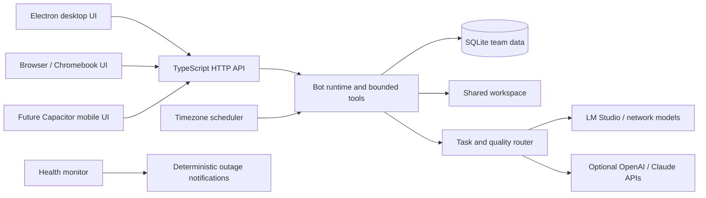

# Bot-Bots architecture and migration plan

Version 0.2 adds bot panels, task journals, reviewed memory compaction, categories/prototypes, concurrent temporary workers, progress milestones, the Google plugin adapter and authenticated server/client access. See [workshop behavior](WORKSHOP.md), [Google setup and permissions](GOOGLE-PLUGIN.md), and [remote access](REMOTE-ACCESS.md) for their current contracts and remaining setup. Google account consent and public tunnel deployment are still user configuration steps.

Version 0.2.3 leads the Google connection with browser sign-in. The publisher/host registers one OAuth app; normal users choose their Google account without copying credentials. The packaged public registration slot is `resources/google-oauth.json`; host environment overrides and Advanced custom-client JSON import remain available. Identity-only sign-in is separate from later selected app scopes. PKCE/state, real loopback callback ports, remote Web-client restrictions, cancellation during exchange, automatic UI refresh and desktop focus preserve the browser handshake. A real publisher registration is not configured in this build; simulated OAuth is used for protocol/UI verification.

## Product contract

Version 0.2.14 gives each bot an isolated in-memory Chromium session and a bounded FIFO browser pool (default six, configurable one to twelve). Parent delegates yield their active slot while retaining their page; scoped turn completion/cancellation releases ownership, and idle worker views can be reclaimed. Human tabs remain separate. [Electron session partitions](https://www.electronjs.org/docs/latest/api/session) without `persist:` keep bot cookies/storage in memory. The UI reports active/queued sessions.

`Services` owns public API catalogs, authenticated-action receipts and Pages ZIP deployment/short-link orchestration. `Credentials` resolves one OS-held key for an entire owner-connected HTTPS API. Bots receive catalog metadata and filtered nested JSON, never the secret. Private setup can reuse existing keys; current service facts refresh before each model reply. Complete API connections authorize their catalog for requested tasks; legacy single-operation approvals and terminal approvals stay independent. Chat uses client message IDs, idempotent send/retry, an optimistic outbox and navigation generations to retain user messages despite older asynchronous responses. Auto-scroll follows only while the user remains at the bottom.

One team, one active host, many clients. A bot is a durable identity with a name, avatar, operating instructions, memory, conversations, routines, and model preference. A model is a replaceable execution resource, not the bot's identity. Moving from a laptop to a GPU server must not require rewriting personas or the UI.

The desktop app hosts the same HTTP API as the headless server. Clients never call LM Studio or a paid model directly: the host applies routing policy, resolves approved OS-held credential bindings (or legacy environment credentials), executes tools, and persists outcomes. GPU inference may run on the same machine or on any reachable model server.

## Modules and ownership

| Module                                        | Responsibility                                                                         |
| --------------------------------------------- | -------------------------------------------------------------------------------------- |
| `packages/shared/types.ts`                    | Transport types shared by UI and server; no Electron imports                           |
| `apps/web/src/`                               | React UI, SVG avatars, connection settings, run activity streaming                     |
| `apps/desktop/main.ts`                        | Electron lifecycle, isolated renderer, embedded server; no bot business logic          |
| `apps/server/app.ts`                          | Validated HTTP API, authentication, origin checks, backup and page routes              |
| `apps/server/runtime.ts`                      | Model/tool loop, coordinator handoffs, cancellation, event trail, workspace boundaries |
| `apps/server/models.ts`                       | Provider discovery, URL normalization, adapters, context budgeting, model ranking      |
| `apps/server/store.ts`                        | SQLite document collections, atomic writes, ratings aggregates, exports                |
| `apps/server/importer.ts`, `memory-import.ts` | Idempotent archive import and migrations without rewriting originals                   |
| `apps/server/scheduler.ts`                    | Pacific-time and other timezone cron scheduling, no surprise catch-up                  |
| `apps/server/alerts.ts`                       | No-model incidents, direct webhook delivery, deduplication, recovery                   |

SQLite uses WAL and atomic upserts. The current store uses typed JSON documents in collections; this deliberately keeps the first migration portable. Before adding multiple users or very large histories, add indexed relational tables for messages, runs, handoffs, and routines through explicit schema migrations. Do not share one SQLite file over a network filesystem or run multiple schedulers against it.

## Routing: human quality first

1. Exclude disabled providers/models, non-chat models, cloud providers in local-only mode, and local models reported unloaded when following loaded models.
2. Healthy/unknown candidates precede offline candidates. Honor a bot's explicit eligible model pin within that availability tier, then the global manual selection if set. Auto mode does not pin the old saved default.
3. Rank by human quality average, using bot/model/task votes when available, otherwise all-bot model/task votes. One vote is sufficient to affect routing. Unrated models start at a neutral 3 for ordering, but are displayed as Unrated. No automated outcome or model self-assessment creates stars. Cost, speed, declared task strengths and priority cannot override a better human quality average.
4. Among equal human quality choices, prefer task fit. For explicitly Soon work, timing feedback and measured speed follow task fit; for Urgent work they precede task fit. Speed is ignored for Relaxed work. A measured speed comparison needs at least three completed jobs for both candidates. Timing votes prefer fewer human too-slow reports; raw model time is a secondary signal. Cost, numeric priority and default model break remaining ties. This is a transparent heuristic with visible sample counts, not a quality guarantee.
5. Attempt the next enabled candidate on failure. Tool results remain in the exchange so a fallback model can see completed work. Tools should still be idempotent before introducing irreversible external effects.
6. If no eligible model can answer, record an incident and call the configured alert APIs without involving a model.

Local OpenAI-compatible providers default to automatic discovery/enablement and following loaded models. Cloud models require explicit enablement. Discovery records `enablement: auto | manual`; refreshing preserves explicit manual choices. Legacy local entries without that field adopt automatic enablement. The host refreshes every 15 seconds even during tasks, at task start and before local inference. Requests for the same provider are coalesced. SSE catalog events update the UI; both the composer and runtime use the same ranking function. Historical run labels retain their original model.

LM Studio's optional `/api/v1/models` metadata distinguishes downloaded models from loaded instances and provides their actual `config.context_length`, tool capability and instance IDs. `/api/v0/models` is a compatibility fallback. The OpenAI `/v1/models` list alone may include downloaded weights when JIT loading is enabled ([LM Studio documentation](https://lmstudio.ai/docs/developer/rest/list)). Native metadata never triggers weight loading. Missing native entries are conservatively treated as unloaded when native metadata is available; generic compatible servers without it use unknown load state and configured context. Non-chat metadata excludes embeddings and image-generation architectures. Effective context is the lesser of the configured/manual cap and reported loaded context; server-controlled context follows reloads automatically. Advertised model maximum is informational, not an allocation.

If selection changes between model requests, the next eligible model receives the completed tool exchange and durable draft checkpoints. The earlier attempt is `switched`, not a model failure; six switches bound automatic recovery. A mid-request server error also refreshes discovery before deciding whether it was a switch. In-flight generations are not forcibly migrated. No eligible model still produces a deterministic task error; idle outage monitoring allows one minute for a reload before notifying. Context/output limits remain task limits, not outages.

Context budgeting estimates token count conservatively and drops old chat messages; it does not replace a tokenizer or summarize older conversations. A larger context does not by itself improve model tool-use quality. The current API returns final answers with live activity events, not token-by-token text.

Tool capability metadata is advisory. Recognized local tool-parser/unsupported-tool errors trigger one text-only retry inside the same measured attempt. Failed-call usage remains unknown, completed tool results remain in context, and model availability is retained. `toolFormatUnsupported` persists through discovery so Auto avoids repeating the broken format on future tasks; per-model `toolCalling` can force Enabled, Text only, or reset Auto compatibility through the editor. A final instruction explains the lack of tool execution, and returned tool calls are rejected when no tools were offered. Ordinary request failures retain normal failover behavior. The current Llama setup rejected native tool output with LM Studio's peg-native error; an isolated 110K-character context stress request also exceeded a five-minute timeout.

Each turn has a stable work record, bot, task category, inherited urgency/importance, final model and separately measured fallback attempts. Provider token usage is stored per model attempt; missing usage remains unknown. Elapsed duration includes tools and child delegation, while model time measures only network completion calls. Feedback attaches only to the delivering bot/model, never to failed alternatives or sibling bots. Votes are updatable and removable; notes and timing judgements remain explicit human data. Existing legacy ratings are preserved, but old aggregate token counts are not misrepresented as per-model telemetry.

SQLite is the authoritative structured lookup store; vectors are unnecessary for exact bot/model/task IDs and numeric scores. An atomic, generated `model-experience.md` report beside the database gives a human-readable table plus feedback history. It is refreshed on startup, completion, feedback and restore, and can be downloaded through the authenticated API. Editing the report does not write back into SQLite. JSON backup/restore preserves the full records. Markdown is an inspection/export surface, not an instruction source.

Urgency and importance are separate human controls, resetting to Relaxed/Normal for each message. High importance requests extra checking in the bot instructions without inventing an urgent deadline. The router does not infer urgency from the kind of task or penalize relaxed work for taking time. Faster routing is best effort; there is no preemptive queue scheduling or deadline guarantee.

Next routing improvements: an evaluation set for writing, page generation, research, and tool use; calibrated confidence intervals; opt-in routing experiments; explicit minimum quality thresholds; and a retry budget shared across an entire handoff tree. Imported sensitive prompts must stay on local endpoints unless cloud use is enabled by the user. Prices in the UI are user-entered estimates, not automatic billing data.

## Host credentials

Production `startServer` attaches a `Credentials` broker; custom hosts embedding `createApp` must supply one to obtain OS-backed storage. The native keyring library uses Credential Manager / Keychain / forced Linux Secret Service, with explicit 0700/0600 private-file mode for headless Linux. External permissions are outside the bot workspace and team backups. A model can use only listed fixed HTTPS operations, with exact one-use owner approval, current grants checked again, redirects refused and scalar response projections/redaction. No raw-secret or grant-write API exists. Model/alert binding IDs resolve only to the exact externally allowed URL/purpose, without environment fallback. Google OAuth vault keys migrate to the OS store and are re-read instead of cached; deleted keys cannot silently reappear for an existing encrypted vault. Bot shell commands are blocked by default once credential controls are initialized. Manual shells and other same-account programs remain outside this logical boundary; a separately isolated execution principal is required for a stronger boundary. See [setup and limitations](SECRETS.md). Pending credential approvals live only in memory and cannot restore permission after a restart.

## Bot collaboration and memory

Progress follows outstanding handoff receipts scoped to the current work record's parent handoff ID. A delegator with unfinished children is parked at 0 with a named waiting label; completed work remains at 100, and active leaf work may use explicit/estimated progress. This avoids treating elapsed coordinator waiting time as work. Parallel and nested waits do not clear when only one sibling returns.

`Settings.mainBotId` is an optional, singular coordinator preference; null means no main bot. Only enabled permanent, non-prototype bots qualify. The owner can change it with `PUT /api/settings/main-bot` without overwriting unrelated settings, or through validated full settings. Bot edits clear an invalid role atomically; startup/restore normalize stale references to null. Selection never starts a run or redirects other conversations. Existing profiles/instructions are retained unchanged.

Fresh runs record `origin: chat | routine`. Only the selected bot's root `chat` turn receives extra coordination guidance in its system prompt, encouraging useful, bounded specialist delegation through actual tools and receipts. Calls from other bots and scheduled/manually run routines do not acquire those extra instructions. No permissions, budgets, model preferences or approvals change. This guidance does not supply unavailable tools or guarantee a model will delegate. The home selector, card/chat badges and roster crown share the stored preference. `tests/main-bot.test.ts` checks role validation, no surprise execution, prompt scope, real delegation, persistence and clearing; `scripts/verify-main-bot.ts` checks desktop/phone controls with an isolated simulated provider.

Handoff delivery is recorded in the SQLite `deliveries` collection. A transaction stores the recipient conversation, incoming peer message and received receipt before any model request. The receipt moves through received/working/completed/failed/cancelled and links sender/recipient/run/conversation IDs. Replies are committed with the completed receipt; errors remain visible in the recipient thread. Stable dispatch keys coalesce in-flight duplicates and return saved answers for completed duplicates. The same key cannot describe different work. Real legacy handoff events can backfill receipts, while old prose/mentions cannot invent past delivery.

Human commands beginning with tell/ask/have/instruct plus a bot mention, or send/forward/pass/route/delegate/assign ... to a bot mention, bypass model-dependent dispatch. Compound requests such as “gather the details, then tell @Worker1” let the sender prepare its result before the runtime guarantees the handoff. The shared parser drives both the composer preview and server routing, honors stable mention IDs and ignores fenced/quoted/negated/status text. Recent source conversation is bounded, quoted reference context rather than fresh authority. The root task waits for delivery results; live steering cannot finish a parent run with a still-unsent explicit handoff. Native bot delegation uses the same mailbox, with the existing depth/cycle/worker/concurrency/approval checks. An inbox receipt proves transport, not model quality or successful execution of arbitrary requested actions.

Recipient inboxes and exact handoff conversations are available from the bot panel and collaboration cards. The system prompt includes recent incoming receipts; bounded receipt questions can be answered directly from storage. On restart or backup restore, interrupted receipts are failed and retained instead of re-executing potentially completed side effects. `/api/bots/:id/inbox` and `/api/deliveries/:id` expose authenticated delivery evidence. `tests/delivery.test.ts` covers command safety, text-only dispatch/context, errors, deduplication, live steering and restart/restore. `pnpm test:delivery` verifies the Electron UI with an isolated simulated provider; setting `BOT_BOTS_DELIVERY_LIVE=1` instead uses the one currently loaded local model without loading other weights.

Running conversations accept live human steering through the normal send endpoint or `POST /api/runs/:id/messages`. The host routes an active conversation to its in-memory run before checking the top-level concurrency limit, so an update does not create a parallel task. Each update is a persisted user message with a steering ID, plus run metadata recording which work records picked it up. Per-run revisions and history-load sequence guards prevent slower polls from undoing newer conversation state. The chat keeps Send/Enter and Stop available together, preserves draft input while sending, and displays queued/applied status. After completion the next message creates a regular follow-up turn in the same conversation.

The runtime tracks individual model requests and cancellable browser actions. New human input aborts stale inference, appends ordered user direction to the existing exchange, and retries on the same model. Interruptions do not mark a provider offline or open an outage incident; unknown interrupted token usage remains partial. Root and delegated turns each consume the update once. Completed tool outputs remain in context, while unstarted calls from an obsolete batch receive explicit cancellation tool results so provider call/result pairing remains valid. A fresh human direction renews the bounded tool allowance. Context trimming preserves the initial task and its completed tool chain across live messages, rather than splitting tool calls from results.

Pending terminal requests are cancelled when direction changes, without granting permission; already approved running processes are not implicitly killed by unrelated chat updates. The human can stop those explicitly. Browser waits can be interrupted without taking control away from the human. Other non-interruptible actions finish at a safe boundary before the updated prompt is used. Updates do not undo already completed side effects. The run accepts up to 50 updates / 48,000 added characters, with the model's context limit still authoritative. Steering IDs and uptake metadata are included in validated backup/restore.

The `delegate` tool makes a scoped, bounded call to another bot, waits for a real response, records a handoff trace, stores the specialist's conversation, and returns its answer. `delegate_workers` adds parallel temporary clones of an explicitly configured prototype, bounded by clone/depth limits and an abortable model semaphore. Root and child work persist task journals; clones retire on success, failure or cancellation. Prototype-linked human ratings inform that prototype's future model routing. Cycles and excessive depth are blocked. The host limits concurrent top-level runs and prevents overlapping runs in one conversation.

The durable inbox and synchronous handoff reproduce the main Boss Man experience. Queued “wake now / queue until next turn” delivery, deliberate retries and resuming interrupted actions remain future work. They need an outbox and explicit retry/side-effect policy; retained receipts must not automatically replay actions. External Texting delivery needs its own service acknowledgement rather than an assistant's statement that something was sent. Never equate a successful model generation with a successful external action.

The archive did not include live memory databases or conversation history. Original memory sections are parsed into shared profile, behavior, world, and workstream collections. The original Markdown is kept verbatim; memory sections are excluded from the imported runtime prompt so the editable Memory store is authoritative. Other historical statements inside role descriptions remain context and should be reviewed. A bot can add memory via a real tool; the UI can review, edit, or remove it.

The host uses an explicit shared file workspace with bounded text-file tools, not an unrestricted shell. The new computer boundary is `apps/server/computer.ts`: the runtime talks to a model-independent `BrowserDriver`, while Electron injects `ChromiumComputer` backed by `WebContentsView`. This keeps browser capability separate from personas, model-provider authentication and the React UI. A future GPU/headless deployment can supply a browser-worker adapter behind the same contract; a plain Node host currently reports the browser as unavailable rather than advertising tools it cannot execute.

Each active bot/run/handoff claims a separate tab. Idle tabs can be reused by that bot after a run, with a cap of 20 open tabs. Commands serialize within a tab; multiple bots never receive the same mutable tab while their jobs overlap. Human takeover pauses new bot actions outside the command queue so human actions do not deadlock behind a waiting bot. Already executing navigation can finish; cancellation aborts waiting bot commands. Tabs, cookies and current pages are computer state, not conversation backups; cookies use a separate persistent Electron session.

The desktop renders real Chromium views, not iframes. A minimal sandboxed preload exposes only validated panel geometry to the trusted app main frame. Arbitrary websites have no preload, Node integration or app session. Remote clients receive authenticated screenshot frames and pointer/text controls through the host API. Browser UI state streams over SSE. Site navigation is limited to public HTTP(S), checks redirect/subresource destinations, blocks local/private/metadata addresses and other protocols, rejects downloads, and denies browser device permissions. This is a browser research workspace, not general OS control. Fixed isolated-world DOM helpers return visible text and fresh snapshot-scoped element refs; models cannot execute arbitrary JavaScript. Stale refs fail after another snapshot/navigation. Web content is explicitly untrusted source data in the model instructions.

`web_search` uses the selected Google/Bing/Brave/DuckDuckGo search page and tries alternatives when results are unavailable. It returns observed result URLs, titles, visible text and refs, never model-invented search results. Dynamic results get a short settling/read retry; verification challenges remain visible for human assistance. The LLM opens sources and cites actual URLs. Search selection persists in settings/backups. Local-only applies to inference providers; searching necessarily sends the query to a public search provider. A deterministic local fixture is allowed only by an explicit host test-origin environment variable for browser integration tests.

## Code, preview and terminal permissions

Chat code uses highlight.js with an explicit set of language grammars and escaped output. Fenced code is never executed by message rendering. Copy and download preserve the actual text; shell blocks can only prefill terminal input. Generated text files reuse the persisted Page document with filename, language, run and optional workspace-path metadata. Existing pages remain compatible. Saved source snapshots and actual download bytes survive backup/restore.

Website previews use opaque sandboxed iframes with `allow-scripts` and strict per-document CSP, allowing inline HTML/CSS/JavaScript while blocking network, frames, forms, workers and privileged app access. An authenticated request creates a 192-bit random preview ticket, exposing only that document for 30 minutes; at most 20 are retained. Normal document navigation avoids inheriting the app's restrictive inline-script policy, while the response's `sandbox allow-scripts` header enforces isolation even when opened directly. Tickets never grant API access or terminal approval. The desktop also injects `ChromiumPreview`, which runs bounded smoke checks in a separate hidden sandbox with no preload, no Node, no network and a 10-second limit. The human can play a saved game in the visible panel independently of that check.

`Terminal` is a host service separate from the model provider. A bot proposal creates a durable awaiting-approval job and an in-memory immutable request. No process exists until the human decision endpoint receives an explicit one-time approval. Approval accepts only the decision, never replacement command/cwd fields. Bots have no approval tool. Manual Run is the human's direct authorization. Each decision and result is saved with bot/run, command, reason, folder, timeout, output, exit code and timestamps. Previously denied commands cannot be requested again within the same run. Cancellation/restart/backup restore never reuse an approval; restored pending/running records become cancelled history.

Each approved command starts a fresh noninteractive PowerShell/sh process. Output streams through authenticated SSE, is displayed as text and capped in storage. Processes have time limits, a four-command concurrency bound and explicit process-tree termination on Stop/shutdown. Initial folders must resolve inside the shared workspace; this is not an OS sandbox, and the approved command runs with the host account's filesystem/process rights. App secrets and startup hooks are filtered from inherited environment variables. Interactive PTY sessions, persistent shell state and allowlists are future extensions; the current permission requirement always applies to every bot command.

The bottom panel supports review, one-time approval/denial, command copy/paste, explicit manual Run, output/history and Stop. It follows new output while the user remains at the bottom. A terminal badge and automatic opening make new requests visible. Side browser/preview bounds shrink to leave room for it. Native clipboard/layout bridges validate the exact trusted main frame and app path; web pages and generated frames have no privileged preload.

## Routines and external effects

All 12 restored routine definitions are paused. Their source prompts remain attached. Several are historical one-time reminders from November 2026 and must be retired or rewritten before activation. Cron expressions are timezone-aware. Runs missed while a host is asleep are not replayed automatically. Long-running routines must not overlap themselves.

Add a routine dependency declaration before unattended production use: required connectors, output contract, maximum duration/cost, and delivery acknowledgement. Historical public-page cleanup must never become a generic deletion job. The page tool saves privately on the host; isolated previews can execute self-contained browser JavaScript. Downloading HTML is separate from publishing.

External connectors need their own durable action records: draft → approval where required → execution → provider receipt → confirmation to sender. A user approval must bind to the exact action payload, recipient, and scope. A model cannot approve its own action. The original rules against unsolicited third-party messages and social posts remain in each bot's instructions; enforce them in the future connector layer as well.

## Platform strategy

| Target             | UI                                   | Agent host                                                            | Current status                                                                               |
| ------------------ | ------------------------------------ | --------------------------------------------------------------------- | -------------------------------------------------------------------------------------------- |
| Windows            | Electron or browser                  | Embedded or Node service                                              | Built and exercised here                                                                     |
| macOS              | Same Electron UI                     | Embedded or Node service                                              | Packaging target configured; native build/sign/test needed                                   |
| Linux / GPU server | Electron optional, browser otherwise | Headless Node service                                                 | Same server source; deployment validation needed                                             |
| Chromebook         | Browser UI, future installable PWA   | Linux environment if available                                        | Responsive browser UI; no Chromebook-specific validation                                     |
| Android            | Future Capacitor wrapper or PWA      | Remote host first; optional dedicated native foreground service later | Native shell and service not implemented                                                     |
| iOS / iPadOS       | Future Capacitor wrapper or PWA      | Remote host for persistent work                                       | Native shell not implemented; background OS limits preclude promising an always-on Node host |

Electron officially targets desktop operating systems, so use Capacitor for native mobile wrappers rather than claiming Electron compiles to iOS/Android. A web manifest is present, but offline caching is not implemented. A mobile shell should bundle the same UI and use an explicit authenticated HTTPS server address. An Android on-device host needs a real native runtime/lifecycle adapter; browser JavaScript alone cannot provide the Node server. An iPhone can be a client and possibly run foreground local tasks later, but cannot be promised as an unattended public server.

Do not implement automatic host election by allowing clients to independently write divergent SQLite stores. Start with export/restore migration and one active authority. Later use a host identity, durable event log, lease, device pairing, encrypted sync, and explicit conflict handling. Model-server failover is implemented; agent-host failover and synchronization are separate future features.

## Migration milestones and acceptance criteria

**Requested November 23, 2026: optional Linux Computer tab.** Keep the existing embedded Chromium panel named **Browser**. Add a separate future **Computer** tab with a lightweight Linux desktop, Google Chrome and terminal, persistent guest files, and explicit human takeover/resume. Prototype QEMU with Debian/Xfce and noVNC, starting with one on-demand VM and adding other guest applications as useful. This milestone is research/planning only; no VM is installed. See [VM options and acceptance criteria](VM-COMPUTER.md).

1. **Local core — implemented.** All personas load; chats/memory/pages persist; Boss Man receives a specialist's answer; avatars save; Qwen handles actual function calls; an unreachable primary falls back to Qwen; outages call a deterministic test webhook; UI navigation and phone width pass.
2. **Extend the shared computer.** Chromium search/navigation, visible tabs, source URLs and human takeover now work on the desktop host. Next: a headless browser-worker deployment, persisted tab restoration, attachments, explicit sensitive-action permissions, and capability-scoped filesystem/process tools. Keep research errors and missing facts visible.
3. **External integrations.** Complete live Google account verification with the implemented OAuth/permission adapter. Add correct Grok folder placement, texting delivery receipts, a Mac Messages bridge if desired, and private/public page hosting with a real publishing acknowledgement. Acceptance: each restored workflow passes against a test account before its routine is enabled.
4. **Better model adequacy assessment.** Build task-specific evaluations and human review history, compare local alternatives, enforce cost budgets, and expose the reason behind routing decisions. Optional cloud adapters already exist but need credentials and live verification. Subscription-based Codex/Claude Code runners would be distinct adapters with their own permissions and lifecycle; they are not implemented by the API adapters.
5. **Always-on server.** Owner login, limited device pairing and scoped API keys are implemented. Finish container/service packaging, a database backup policy, OS keychain integration, TLS/tunnel deployment, broader operational rate limits, background service restart, and an external watchdog for a dead host. The ownership lock prevents duplicate desktop/headless schedulers. Acceptance: public deployment and reboot/interrupted-run recovery pass without duplicate deliveries.
6. **Cross-platform releases.** Build/sign desktop artifacts on each OS. Add Capacitor mobile projects and secure remote pairing. Test low-memory devices, accessibility, touch targets, offline state, and host-unavailable UX. Acceptance: a phone and Chromebook can use the same hosted team without making their own conflicting copy.

## Verification evidence

`Drafts` stores source independently of provider context. Each append/patch requires the latest revision, and exact patches must match once. Checkpoints retain a bounded head, tail and outline; old successful notebook calls/results are compacted together without breaking provider tool-call pairing. The latest two operations remain verbatim. Notebook operations have their own bounded allowance so writing many small chunks does not consume the ordinary tool budget.

Draft objectives preserve the originating human task or delegation brief. Section reads also return the latest human steering message. A failed specialist returns saved draft IDs/revisions to its coordinator. Interactive HTML can be checked with up to eight validated preview actions: CSS-selector clicks and exact text expectations. These execute only inside the existing isolated generated-page sandbox and report observed values/failures. Rendering without such checks is explicitly described as insufficient to verify interactive behavior.

`OutputRecovery` handles provider length/max-output stop reasons before tool dispatch. Partial tool payloads never execute. Verified code string prefixes may seed a draft; interrupted appends require an explicit matching revision and the same run/work owner. Plain text continues from a replaceable checkpoint and is assembled into one final reply. Human steering supersedes an obsolete automatic text draft. All provider-reported usage is counted across chunks. Context/output/tool limits use `TaskLimitError` and preserve model health; transport/provider failures retain normal fallback behavior. The harness automatically renews ordinary tool stages while progress is made and resumes unfinished files. Limits are 64 output recoveries, 512 notebook operations per work item, 32 ordinary stages, 20 drafts per active run, 6,000 characters per explicit append/patch field and 250,000 characters per draft. Repeated lack of progress, cancellation and real access/approval blockers still stop the task. Empty visible answers get bounded reasoning-disabled retries; actual returned teammate results survive an unavailable final summary.

Restart/cancellation leaves unfinished drafts partial. Backup restore preserves source/revisions and never resumes a writer or approval automatically. Continue creates or steers a normal run in the original conversation with its draft ID, task and latest human direction. During normal active work, truncation or an unfinished file continues automatically. Partial HTML offers a clearly labeled live preview. The UI polls lightweight build summaries and loads full source only for an open preview. The OpenAI-compatible local path consumes SSE text/tool deltas; in-flight arguments never execute. Reasoning deltas are neither stored nor shown. A bounded live build is an ephemeral projection of committed draft content plus the current visible output; committed files remain durable.

`tests/drafts.test.ts` covers partial JSON decoding, guarded recovery, revision conflicts, checkpoint compaction, assembled replies/usage, distinct task limits, bounded notebook work, steering, backup/restore and explicit continuation. `scripts/verify-drafts.mjs` forces real Qwen output truncation, then checks saved-draft download, reload, stop/resume, and a working counter website in the packaged Chromium preview using an isolated team.

`tests/core.test.ts` exercises archive fidelity, idempotent import, URL handling, local-only routing and task feedback, Pacific DST scheduling, explicit discovery policy, failover, deterministic alerts, real saved artifacts, workspace escapes, and HTTP access validation. `tests/model-discovery.test.ts` checks automatic local vs opt-in cloud enablement, native v1/v0 and generic servers, manual overrides, loaded context bounds, request coalescing and model changes without repeating completed tools. Provider protocol tests use local simulated endpoints, not paid services.

`scripts/verify-local.ts` and the original `scripts/verify-ui.mjs` explicitly use Qwen. Run those only when that is intended. `scripts/verify-discovery.mjs` uses the single currently loaded local model and an isolated Electron team to check automatic polling, the real composer label/reply, model editor and persistence of manual disablement. `scripts/verify-context.ts` sends a real request above the previous 32K budget to a currently loaded model with at least 96K context, and verifies provider-reported usage. Their evidence is under `test-results/discovery/`; test data is isolated from `data/`.

## Documentation used

- [Electron platforms](https://www.electronjs.org/docs/latest) and [security guidance](https://www.electronjs.org/docs/latest/tutorial/security).
- [LM Studio's compatible Chat Completions API](https://lmstudio.ai/docs/developer/openai-compat/chat-completions) and [tool use](https://lmstudio.ai/docs/developer/openai-compat/tools).
- [Capacitor platform model](https://capacitorjs.com/docs).
- [OpenAI Responses migration and reasoning items](https://developers.openai.com/api/docs/guides/migrate-to-responses).
- [Claude tool-use message protocol](https://platform.claude.com/docs/en/agents-and-tools/tool-use/overview).

## Reliable specialist work and prototypes (0.2.12)

Before main-bot inference, clear research/site/game tasks route through durable delivery receipts. Research precedes a requested build, and actual returned evidence accompanies the builder brief. Explicit human handoffs take precedence. The heuristic does not arbitrate arbitrary tasks; native delegation remains available for those. Quoted, negated and status-only messages do not authorize worker launches.

Direct prototype human runs return HTTP 409. A requesting bot delivers to the prototype coordinator, which owns clone receipts, gathers actual results and performs one synthesis turn before replying to its caller. Coordinator synthesis cannot delegate again. Clones retire and discard copied profile instructions; identity, task/result and learning records remain available. Category-only PATCH preserves profiles; active clone placement follows the prototype.

All provider paths normalize system messages into one leading instruction before context fitting, including recovery and no-tool notes. The local streaming parser follows [LM Studio tool delta documentation](https://lmstudio.ai/docs/developer/openai-compat/tools) and [stream usage support](https://lmstudio.ai/docs/developer/api-changelog). Local HTML creation requires no remote authentication; no public URL is asserted without a successful publishing operation. Runtime tail rules override archived tool assumptions. Unsafe credential setup requests in final replies are replaced with the in-app manager path; the OS credential broker and operation approvals remain the actual access boundary.
